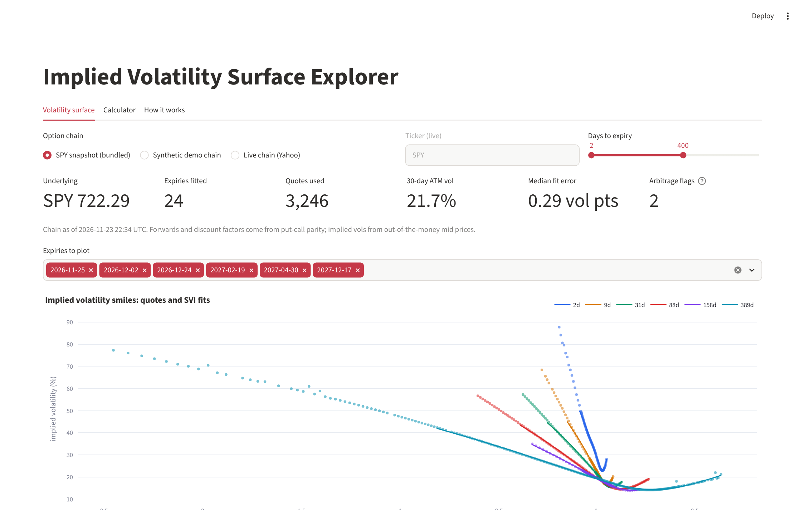
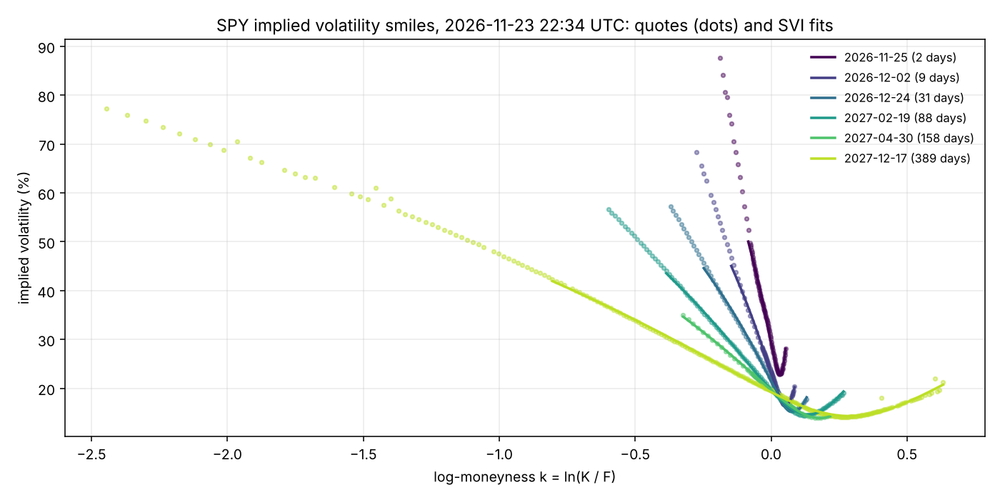
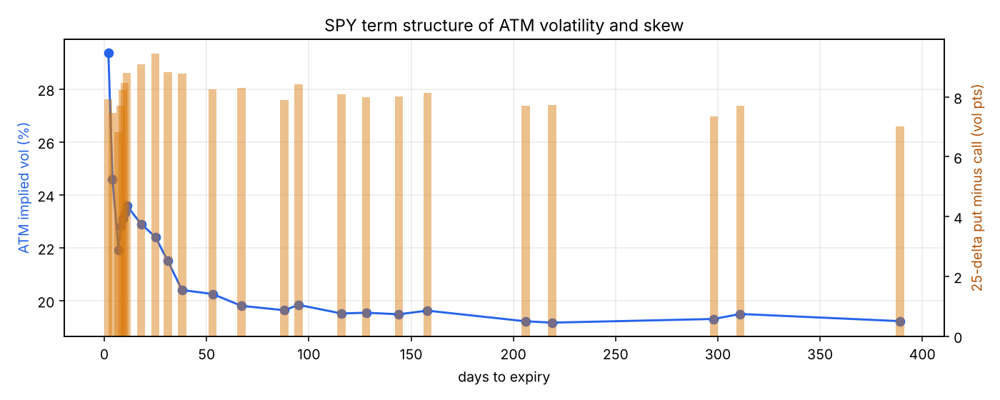

[](https://github.com/AkshayJha22/Black-Scholes-Option-Pricing-Model/actions/workflows/tests.yml)

# Implied Volatility Surface Explorer

A Streamlit app that turns a listed option chain into an implied volatility
surface: implied volatilities from quotes, an SVI smile per expiry, a fitted
surface, and static-arbitrage checks. It started as a Black-Scholes
calculator, which is still here as a tab, with the bugs of the first version
fixed and tested.



## What it does

* **Loads a chain** from three sources: a real SPY chain bundled in `data/`
  (8,375 quotes across 25 expiries, captured on 23 November 2026), a synthetic
  chain priced from a known arbitrage-free surface, or a live chain from Yahoo
  Finance.
* **Cleans it**: keeps two-sided quotes (bid above zero, ask above bid) with a
  relative spread under 50%, and uses mid prices.
* **Reads the forward and discount factor of each expiry off put-call
  parity**: C - P = DF (F - K) for every strike, so a straight-line fit of
  C - P on K near the money gives both. No rate or dividend assumption needed.
* **Computes implied volatilities** of out-of-the-money options (Black-76 on
  the forward), with Newton steps inside a shrinking bisection bracket, and
  their Greeks.
* **Fits SVI** to every expiry, plots the smiles, the term structure of ATM
  volatility and skew, the risk-neutral density and a 3-D surface.
* **Checks for static arbitrage**: butterfly (negative risk-neutral density,
  from the fitted smile, and executable butterflies in the quotes themselves)
  and calendar (total variance falling with maturity).

## Results on the bundled SPY chain

Reproduce with `python scripts/make_figures.py`.

| | |
|---|---|
| Spot | 722.29, captured 23 Nov 2026 22:34 UTC (after the close) |
| Quotes used | 3,246 of 8,375 (out of the money, two-sided, within 4 ATM standard deviations) |
| Expiries fitted | 24, from 2 to 389 days |
| 30-day ATM implied volatility | 21.7% |
| SVI fit error | median 0.29 vol points, worst 0.51 |
| 25-delta put minus 25-delta call | 6.8 to 9.5 vol points across expiries |
| Butterfly (fitted smiles) | 23 of 24 expiries clean; the 206-day slice dips just below zero (g = -0.0013) |
| Calendar | one flag: the 7-day slice sits 0.10 vol points under the 4-day one at its worst point, at the 0.1-point threshold |
| Executable butterflies in the quotes | 25, all in five long-dated expiries (128 to 389 days); the snapshot was taken after the close, when long-dated quotes are often stale |





The surface shows the usual equity shape in a stressed market: steep put skew
at every maturity, short-dated volatility above long-dated (an inverted term
structure, with the VIX near 36 three days earlier), and a smile that
flattens in log-moneyness as maturity grows.

## The maths in plain language

**SVI.** For one expiry, total implied variance w = vol^2 x T is modelled as a
function of log-moneyness k = ln(K/F):

`w(k) = a + b ( rho (k - m) + sqrt((k - m)^2 + sigma^2) )`

a sets the level, b the steepness of the wings, rho the tilt (negative for
equity skew), m shifts the smile sideways and sigma rounds its bottom. The
wings are straight lines, as theory says they must be at extreme strikes
(Lee's moment formula caps their slopes at 2). The fit minimises volatility
errors with a robust loss, keeps m inside the quoted range so one wing cannot
be left to explode, and is penalised for negative density.

**Butterfly arbitrage.** Call prices must be convex in the strike: a
butterfly (long one call at each outer strike, short two in the middle)
never pays less than zero, so it cannot cost less than zero. Equivalently the
risk-neutral density must be non-negative. For an SVI smile the density is
proportional to

`g(k) = (1 - k w' / (2w))^2 - (w'^2 / 4)(1/w + 1/4) + w'' / 2`

(Gatheral and Jacquier, 2014), checked on the quoted range. The quotes are
also checked directly: buying the wings at the ask and selling the body at
the bid must not produce a negative cost.

**Calendar arbitrage.** At a fixed log-moneyness, total variance must not
fall as maturity grows, otherwise selling the short option and buying the
long one locks in a profit. Drops worth less than 0.1 vol points are treated
as fitting noise.

**The synthetic chain.** Prices come from a power-law SSVI surface (Gatheral
and Jacquier, 2014), which is arbitrage-free for the parameters used, plus
quote noise and a spread. Because the answer is known, the tests check that
the pipeline recovers it and that injected arbitrage is caught.

## The calculator, and what version 1 got wrong

The calculator prices European calls and puts with Black-Scholes-Merton
(dividend yield included), shows all Greeks, solves for implied volatility
with clear messages outside the no-arbitrage bounds, draws price heatmaps
over spot and volatility, and values one option from purchase to expiry along
a real (Yahoo) or synthetic price path.

Version 1 had four bugs, each now pinned by a test:

| Bug in version 1 | Now |
|---|---|
| `bs_delta(..., 'CALL')` compared the type without lower-casing and returned the put delta (-0.376 instead of 0.624) | Option types are case-insensitive everywhere |
| Zero volatility or zero time raised `ZeroDivisionError` | Prices and Greeks return their exact limits (discounted intrinsic value) |
| An invalid option type printed a message and returned `None` | It raises `ValueError` |
| The history chart computed time to expiry so that it **rose** along the chart, pricing the oldest third of the window at expiry | An option is bought at the money on the first day and its time to expiry falls to zero |

Also fixed: inputs that only accepted whole numbers (integer defaults), a
volatility slider whose default started below its own minimum, a README that
described a Plotly chart the app did not draw, and a committed `__pycache__`.

## Running it

```bash
pip install -r requirements.txt
streamlit run app.py              # opens at http://localhost:8501
python -m pytest -q tests         # 33 tests, about 40 seconds
python scripts/make_figures.py    # refits the SPY snapshot, rewrites results/
```

The SPY snapshot is captured on GitHub's runners, which can reach Yahoo
Finance, by `.github/workflows/chain-snapshot.yml` (run it from the Actions
tab); the app also loads live chains when you have internet.

## Tests

`tests/` runs on every push (GitHub Actions):

* pricing: the textbook reference value, put-call parity, Greeks against
  finite differences, implied-volatility round trips (vectorised solver
  against Brent's method), NaN rather than an exception outside the bounds,
  and one test per version 1 bug;
* SVI: SSVI-to-SVI conversion, the density integrating to one, parameter
  recovery on a noise-free synthetic chain (within 10%), smile recovery within
  0.4 vol points with quote noise, forwards and discount factors recovered
  from put-call parity, a clean surface passing every check, and injected
  butterfly and calendar arbitrage being flagged;
* the real SPY surface fitting with sensible numbers, the option-ageing path,
  and the app rendering without exceptions.

## Project layout

```
app.py                    Streamlit UI only
ivsurface/bs.py           Black-Scholes-Merton and Black-76 prices, Greeks, implied volatility
ivsurface/svi.py          raw SVI, SSVI, fitting, butterfly and calendar checks
ivsurface/chain.py        loading, cleaning, parity forwards, implied vols, the fitted surface
ivsurface/synthetic.py    synthetic chains from a known SSVI surface
ivsurface/calculator.py   an option valued from purchase to expiry
ivsurface/plots.py        Plotly figures
scripts/snapshot_chain.py captures a chain (run by the chain-snapshot workflow)
scripts/make_figures.py   fits the snapshot and writes results/
data/, results/           the SPY snapshot and the outputs above
tests/                    pytest suite
```

## Limitations

* One snapshot, taken after the close: long-dated quotes may be stale, which
  is the likely source of the executable butterflies found.
* Each expiry is fitted on its own; the slices are checked for calendar
  arbitrage but not fitted jointly (an SSVI or eSSVI fit would guarantee it).
* American exercise is ignored: SPY options are American, but only
  out-of-the-money quotes are used, where the early-exercise premium is small.
* Deep wings (beyond 4 ATM standard deviations) are left out of the fits.

*Educational project, not investment advice.*
